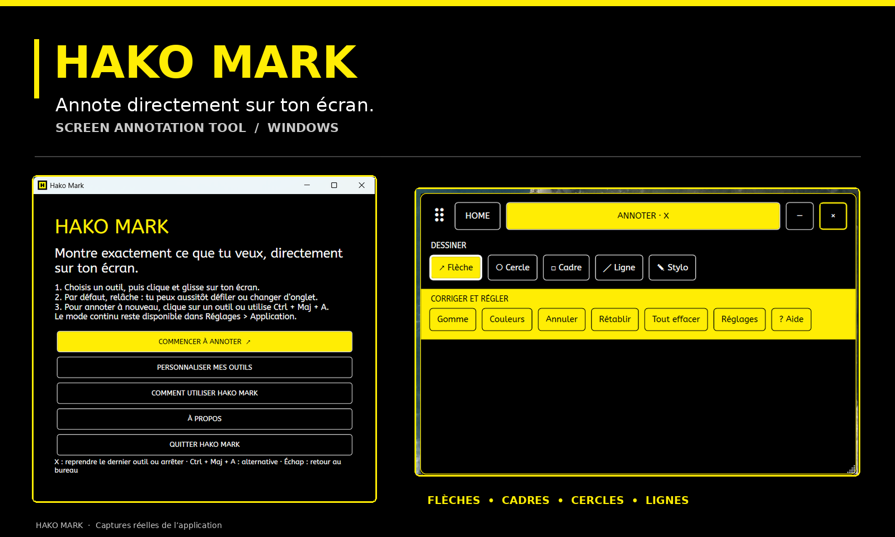
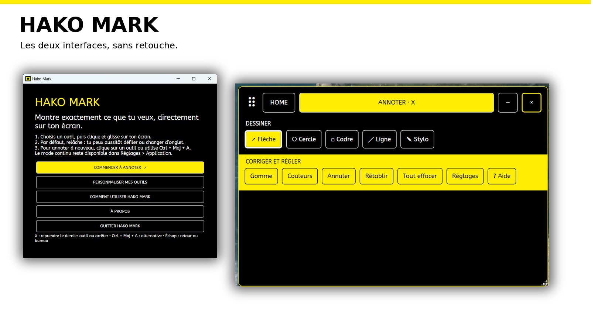

# Hako Mark

Hako Mark est une application Windows pour dessiner directement sur son écran pendant une présentation, une réunion ou une vidéo. Elle permet de tracer des flèches, cercles, cadres, lignes et annotations à main levée.

Créée par Adeline Courtois, graphiste, dans l’univers HakoTools. Version actuelle : **0.3.3**.

## Les deux interfaces

L’accueil permet de commencer à annoter, de personnaliser les outils et d’ouvrir l’aide. La barre d’annotation donne accès aux formes, aux couleurs, à la gomme et à l’historique pendant l’utilisation.



## Télécharger et installer

1. Sur GitHub, ouvre **Releases** et télécharge l’archive `Hako-Mark-v0.3.3-Windows.zip`.
2. Décompresse-la, puis double-clique sur `Installer Hako Mark.exe`.
3. Dans la fenêtre qui s’ouvre, clique sur **INSTALLER HAKO MARK**. Une icône Hako Mark apparaît sur le Bureau.

Le dossier téléchargé contient également `Desinstaller Hako Mark.exe`, `Aide Hako Mark.txt` et les conditions d’utilisation. Garde-le si tu souhaites désinstaller plus tard. Une réinstallation par-dessus une version précédente conserve les préférences. L’application est prévue pour **Windows 10/11, 64 bits** ; aucun SDK .NET n’est nécessaire pour l’utiliser.

> Le bouton **Code > Download ZIP** télécharge le code source pour les développeurs, pas le dossier d’installation. Utilise **Releases** pour installer Hako Mark.

## Utiliser Hako Mark

Choisis un outil dans la barre, puis clique et glisse sur l’écran. Par défaut, après chaque tracé, la souris redevient disponible pour défiler, cliquer ou changer d’onglet. Le dessin reste affiché selon la durée choisie. Les annotations sont fixées à l’écran et ne suivent pas un mot lorsque la page défile.

La touche **F8** reprend le dernier outil choisi ; un nouvel appui arrête l’annotation. Elle est personnalisable dans **Réglages > Application**, par exemple avec X. Une lettre choisie est réservée à Hako Mark tant que l’application tourne. **Ctrl + Maj + A** reste disponible.

Pour dessiner plusieurs éléments sans interruption, décoche **« Une annotation, puis retour automatique à la navigation »** dans **Réglages > Application**. Dans ce mode, la touche choisie lance le dessin et le prochain appui le termine. Le bouton **? Aide** de l’application explique les outils et raccourcis.

## Utilisation et propriété

Hako Mark est mis à disposition gratuitement pour un usage personnel ou au sein de ton activité professionnelle, y compris pour réaliser des présentations et vidéos. Tu peux modifier le code pour employer ton propre branding dans une version utilisée en privé. La vente, la revente, la mise à disposition et la redistribution du logiciel ou d’une version modifiée nécessitent l’autorisation écrite d’Adeline Courtois. Les détails figurent dans [LICENSE.md](LICENSE.md).

Le code source est visible pour permettre l’étude et l’adaptation privée. Ces conditions ne sont pas une licence open source. Le nom Hako Mark et l’identité d’Adeline ne sont pas cédés. La police ABeeZee conserve sa [licence propre](src/HakoMark.UI/Fonts/OFL.txt).

## Pour les développeurs

Sur Windows, installe le **SDK .NET 10**, puis exécute :

```powershell
dotnet build HakoMark.sln -c Release
dotnet run --project tests/HakoMark.Tests -c Release
./installer/Build-Installer.ps1
```

Le paquet est créé dans `release/Hako Mark Installer`. Le programme est une application WPF autonome pour Windows 64 bits. Ses préférences sont conservées séparément dans `%LOCALAPPDATA%\HakoTools\HakoMark.Preferences\settings.json`.

Pour adapter l’apparence à ta marque, consulte [le guide de personnalisation](docs/PERSONNALISATION.md). Les changements de branding nécessitent actuellement une modification du code et une recompilation ; il n’y a pas encore de bouton de thème dans l’application.

Les tests automatisés vérifient notamment les outils de dessin, l’historique, les raccourcis enregistrés et un rendu hors écran. Le comportement dans tous les logiciels Windows, les configurations multi-écrans et les logiciels de capture doit encore être vérifié manuellement.
